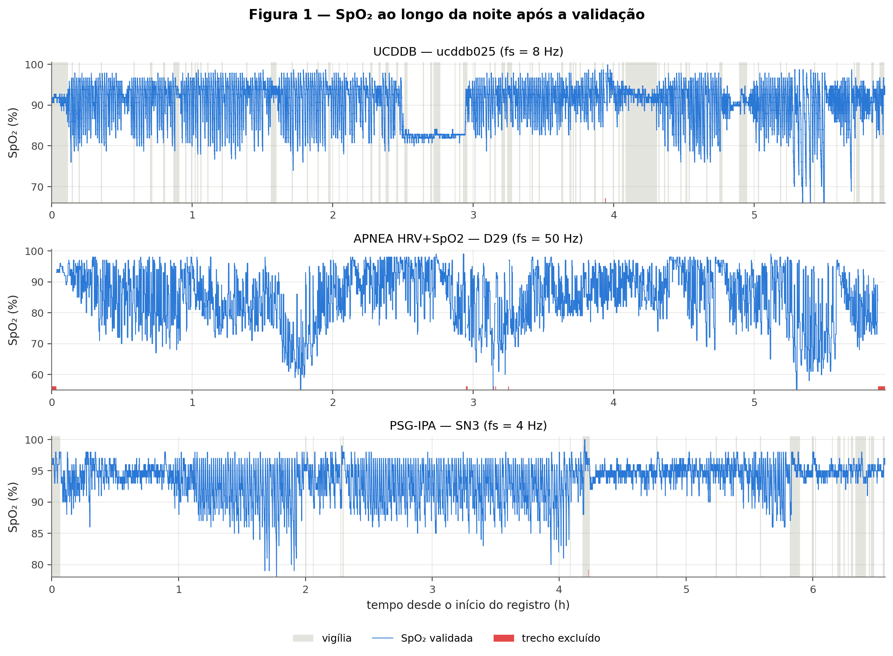
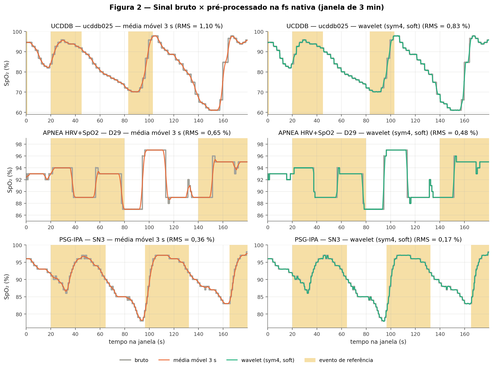
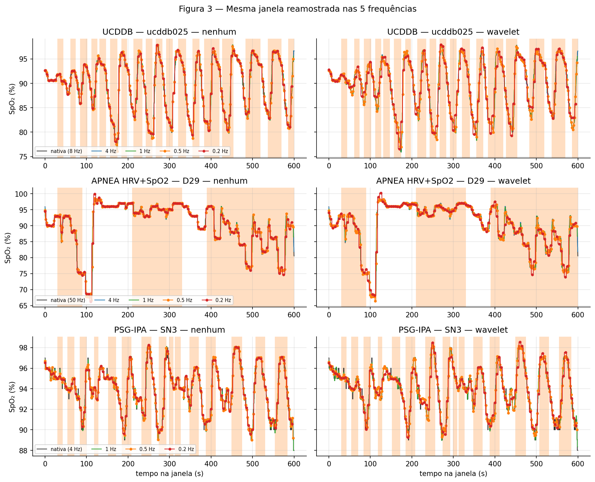
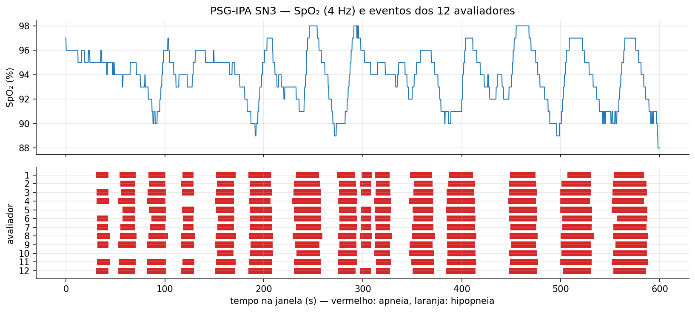

# Efeito da frequência de amostragem e do pré-processamento da SpO₂ na detecção de apneia do sono por ODI

Avaliar, de forma controlada, como a frequência de amostragem e o pré-processamento da SpO₂ afetam a detecção de
apneia do sono por um detector de dessaturações (ODI 3 % e 4 %), aplicado à base pública UCDDB e medido por
sensibilidade e preditividade positiva em relação aos eventos anotados e pela concordância ODI × IAH.

Projeto final de **Expressão Gráfica Computacional** — Engenharia Biomédica, PUC-Campinas (2026).
Dupla: Lara Madaschi Heinrich Piaia (RA 24025386).
Protocolo de 1 página: [`docs/protocolo_entrega2.pdf`](https://github.com/LaraMHP/-Trabalho-Final-da-Disciplina-de-Expressao-Grafica-Computacional/blob/839b47b436a37adbfdc9cc0f6791bd8dfa263ae2/Protocolo.pdf).]

Referência: Yam, K. J. M. et al. *Artificial intelligence diagnosis of obstructive sleep apnea using overnight
pulse oximetry: a systematic review and Bayesian meta-analysis.* JMIR, v. 28, e80349, 2026.
DOI: [10.2196/80349](https://doi.org/10.2196/80349).

## Executar

Notebook no Colab: https://colab.research.google.com/drive/1uxt-1fSJ_0WcgO7SjcVXo3Bt1tcIPngu
1. Abra `notebooks/Código aquisição e processamento.ipynb` no Google Colab (já salvo com as saídas da execução)
   e, para reproduzir, use **Ambiente de execução → Executar tudo**.
2. Autorize o acesso ao Google Drive: os dados ficam na pasta `egc_apneia` e não são baixados de novo
   (para não usar o Drive, troque `USAR_DRIVE = True` por `False`).
3. O Mendeley Data bloqueia download automático: baixe o .zip pelo botão **Download All** da
   [página da APNEA HRV+SpO2](https://data.mendeley.com/datasets/cdxs63gdzc/1) e envie-o quando o botão
   **Escolher arquivos** aparecer na Seção 1.
4. O notebook baixa UCDDB e PSG-IPA (~2 GB), confere a integridade, processa as três bases e grava tudo em
   `saidas/`; a Seção 11 gera `saidas_entrega2.zip` com tabelas e figuras.

Para rodar localmente: `pip install -r requirements.txt` e execute o notebook.

## Bases

| Papel | Base | Versão | DOI | Licença | SpO₂ | Referência |
|---|---|---|---|---|---|---|
| Principal | [UCDDB](https://physionet.org/content/ucddb/1.0.0/), PhysioNet | 1.0.0 | [10.13026/C26C7D](https://doi.org/10.13026/C26C7D) | ODC-By 1.0 | EDF, 25 noites | apneias/hipopneias com início e duração (1 técnica) |
| Externa 1 | [APNEA HRV+SpO2](https://data.mendeley.com/datasets/cdxs63gdzc/1), Mendeley Data | 1 | [10.17632/cdxs63gdzc.1](https://doi.org/10.17632/cdxs63gdzc.1) | CC BY 4.0 | 50 Hz, janelas de 5 min deslocadas de 1 min, 83 sujeitos | apneia/não apneia por minuto (`salida_man_1m`) |
| Externa 2 | [PSG-IPA](https://physionet.org/content/psg-ipa/1.0.0/), PhysioNet (tarefa respiratória) | 1.0.0 | [10.13026/esx0-nw71](https://doi.org/10.13026/esx0-nw71) | CC BY 4.0 | EDF+, 4 Hz, 5 PSGs | eventos de 12 avaliadores |

A data de acesso de cada base fica em `saidas/registro_acesso.json`. UCDDB e PSG-IPA são conferidas com o
`SHA256SUMS.txt` publicado; para a APNEA HRV+SpO2, que não publica hashes, o notebook gera
`saidas/manifesto_sha256_apnea_hrv_spo2.csv`. Os dados **não** são versionados no repositório (ver `.gitignore`).

A APNEA HRV+SpO2 é descrita em Martín-González, S. et al. *Combining heart rate variability and oximetry to
improve apneic event screening in non-desaturating patients.* Sensors, v. 23, n. 9, 4267, 2023.
DOI: [10.3390/s23094267](https://doi.org/10.3390/s23094267).

## Resultados da Entrega 2

Acesso às três bases em 11/11/2026; integridade conferida (UCDDB 77/77 e PSG-IPA 65/65 arquivos pelo SHA-256
publicado; APNEA HRV+SpO2 com manifesto de 249 arquivos).

### Metadados de aquisição da SpO₂

| | UCDDB | APNEA HRV+SpO2 | PSG-IPA |
|---|---|---|---|
| Canal / formato | `SpO2`, EDF | `SAT`, .mat | `SaO2`, EDF+ |
| fs | 8 Hz | 50 Hz | 4 Hz |
| Resolução | 12 bits efetivos (−2048 a 2047) | não informada (passo 0,0092 %) | 8 bits efetivos (0 a 255) |
| Ganho | 0,0237 %/LSB (0–97 %) | não informado | 1 %/LSB |
| Unidade | % | % (assumida) | % |
| Filtros | HP 0 Hz, LP 0 Hz (nenhum) | não informados | não informados |

### Descrição das bases

| | UCDDB | APNEA HRV+SpO2 | PSG-IPA |
|---|---|---|---|
| Registros | 25 | 83 (38 controles, 34 dessaturantes, 11 não dessaturantes) | 5 |
| Duração (h), média ± dp (faixa) | 6,93 ± 0,54 (5,93–7,71) | 6,77 ± 1,32 (3,12–7,90) | 6,92 ± 1,01 (5,76–8,41) |
| Horas gravadas / válidas para análise | 173,4 / 133,1 (só sono) | 562,3 / 555,6 | 34,6 / 29,7 (só sono) |
| Referência | 695 apneias e 2623 hipopneias; IAH 2–91 | 34.003 minutos rotulados, 23,1 % com apneia | média de 335 apneias e 133 hipopneias por avaliador; IAH 4–53 |

Checagens: o IAH recalculado pelas anotações da UCDDB reproduz o IAH da polissonografia; a SpO₂ cai após os
eventos anotados (UCDDB e PSG-IPA); na APNEA HRV+SpO2, janelas vizinhas se sobrepõem em 4 min em 100 % dos pares e
a % de minutos com apneia segue os grupos (2,2 % controles, 50,5 % dessaturantes, 33,8 % não dessaturantes).
ND5 e D23 têm mais rótulos que minutos de sinal (212 e 11 min).

### Sinal bruto e pré-processado






As dúvidas sobre o detector (Etapa 4) estão na Seção 9 do notebook.

## Estrutura

```
notebooks/   Código aquisição e processamento.ipynb   download, leitura, conversão, validação, pré-processamento, figuras
docs/        protocolo_entrega2.pdf                   protocolo de 1 página
saidas/      registro_acesso.json, metadados_aquisicao.csv, metadados_por_base.csv,
             descricao_bases.csv, descricao_bases_resumo.csv, relatorio_validacao.csv,
             psgipa_eventos_por_avaliador.csv, manifesto_sha256_apnea_hrv_spo2.csv,
             resumo_entrega2.json, figuras/
dados/       (ignorado pelo git) arquivos originais das três bases
```

## Pipeline

1. Aquisição e leitura (EDF → unidade física pelo cabeçalho; APNEA HRV+SpO2: sinal contínuo pelo minuto central de cada janela) — **entrega 2**
2. Validação da SpO₂ (zeros, fora de 50–100 %, saltos > 4 %/s, lacunas ≤ 10 s interpoladas, vigília excluída) — **entrega 2**
3. Reamostragem (nativa, 4, 1, 0,5, 0,2 Hz) × pré-processamento (nenhum, média móvel 3 s, wavelet) — **entrega 2**
4. Detecção de dessaturações (ODI 3 % e 4 %)
5. Avaliação na UCDDB (sensibilidade e preditividade positiva por evento; ODI × IAH)
6. Validação nas bases externas com parâmetros congelados

## Código de terceiros

Bibliotecas usadas como dependência, sem cópia de código: NumPy, SciPy, pandas, Matplotlib (BSD/PSF),
pyEDFlib (BSD), PyWavelets (MIT), xlrd (BSD), wfdb (MIT), h5py (BSD). O detector de dessaturações é implementado
pela dupla.
